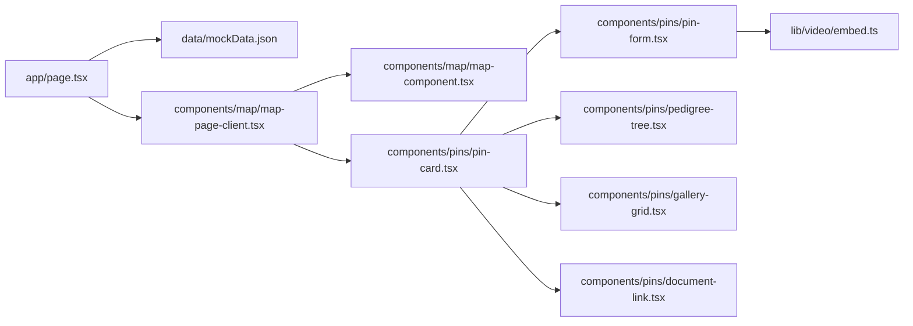

# PetsMap MVP

## Overview

`PetsMap` is an interactive web application for the National Breed Club "Честный знак". The MVP centers on a full-screen map where users can open detailed profile cards from pins and create new draft markers directly from the map surface.

## Architecture

The application uses a thin server entry point and a client-side interaction shell:

`app/page.tsx` reads URL query params and injects initial state into `MapPageClient`. The client layer owns selection, draft creation, local persistence during the session, and modal orchestration. The map is rendered client-side through `maplibre-gl` with a raster OpenStreetMap style object, custom markers, and a separate user-facing source badge.

## Interface

### Map

- Full-screen MapLibre map with raster OpenStreetMap layer
- Marker list loaded from `mockData.json`
- Click on an existing marker: open detail modal
- Click on map background: create draft pin at clicked coordinates
- `Добавить метку`: opens a new draft at the fallback/current center area
- The UI keeps Russian/local map labels, avoids the default provider attribution panel, and uses custom floating actions instead of a large hero block

### Modal Card

- Modes: `view`, `edit`, `create`
- SEO output in `view` mode:
  - role/type as `<h1>`
  - breed as `<h2>`
- Blocks:
  - profile summary
  - titles
  - dysplasia document
  - pedigree
  - photo gallery
  - safe embedded video

## Data Model

Core entity: `PinRecord` in `types/pin.ts`.

It includes:

- role and species metadata
- breed and pet name
- birth date
- titles
- location coordinates
- city and contact
- description
- rainbow status
- pedigree tree
- dysplasia document
- gallery images
- video URL

## Configuration

No environment variables are required for the MVP.

Relevant config files:

- `next.config.ts`
- `tsconfig.json`
- `postcss.config.mjs`
- `eslint.config.mjs`
- `components.json`

## Constraints & Decisions

- MapLibre with a raster OpenStreetMap layer was chosen to keep the map stable, Russian-friendly, and free of API keys.
- Data is mock-driven to accelerate UI delivery before backend design.
- Video embeds are restricted to trusted VK/RuTube patterns; raw iframe URLs are not accepted.
- Gallery preview is intentionally limited to supported HTTPS demo image hosts until a real upload/storage flow exists.
- File uploads are represented as UI placeholders only in this iteration.
